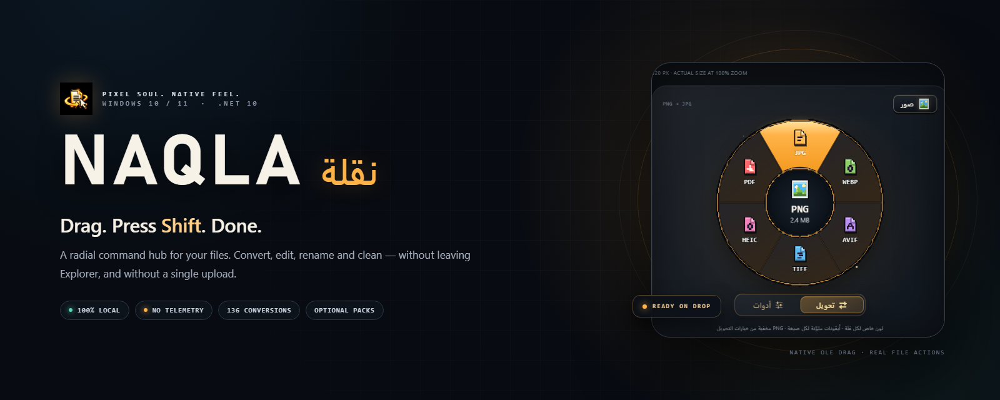
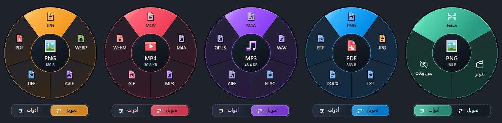
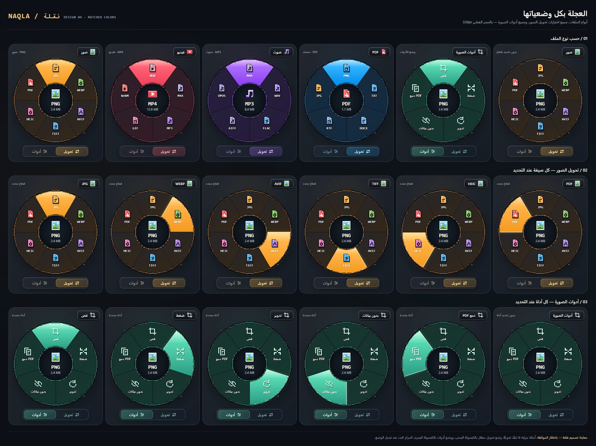
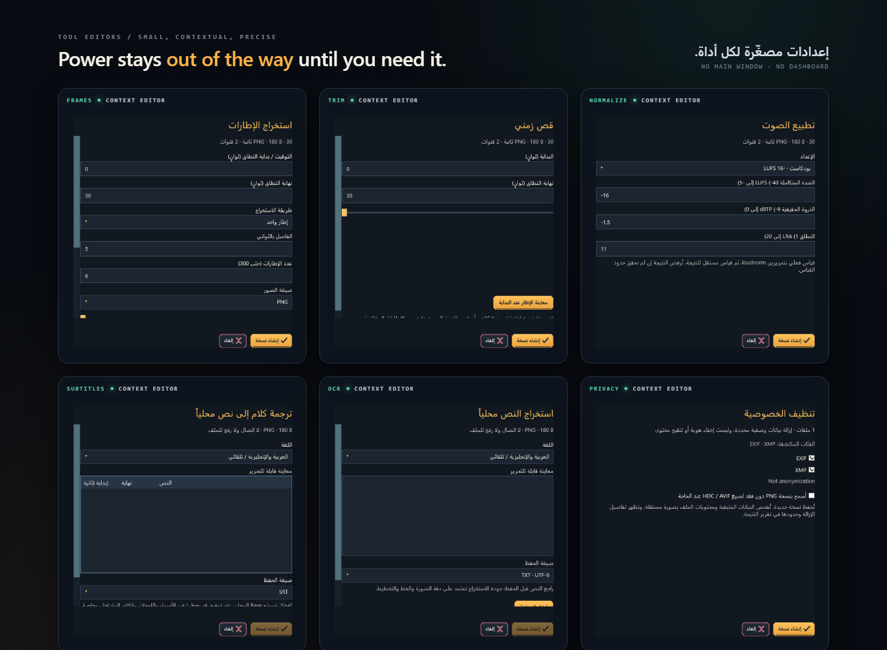
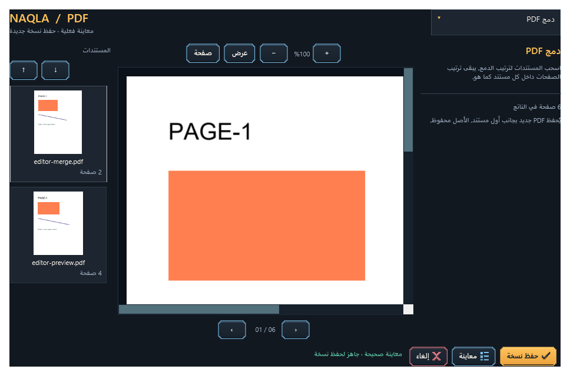

<div align="center">
  

  <br>

  **اسحب ملفاً. اضغط Shift. كل ما تحتاجه يظهر حوله.**

  أداة Windows تعمل في شريط النظام للصور والوسائط والمستندات المحلية المدعومة.<br>
  بلا نافذة رئيسية، بلا رفع، بلا تتبّع.

  <br>

  
  
  
  
  

  <br>

  [معاينة الواجهة مباشرة](https://realfiras.github.io/naqla/) · [English](README.md) · [التدقيق الكامل](docs/FINAL-FEATURE-AUDIT.md) · [القيود](docs/KNOWN-LIMITATIONS.md) · [الأمان](docs/SECURITY-REVIEW.md)
</div>

<div dir="rtl">

> [!WARNING]
> **نسخة تطوير 0.8.** المعالجة المحلية الفعلية وأدلة القبول الآلي موجودة، لكن اختبار Windows الفعلي والتثبيت على حساب نظيف ما زالا معلّقين. هذه ليست نسخة مستقرة عامة.

## ابدأ من هون

- **طريقة الاستخدام:** [الدليل العربي](docs/GETTING-STARTED.ar.md) · [English guide](docs/GETTING-STARTED.md).
- **كيف أثبّته؟** [خطوات تنزيل المثبّت وتثبيته وتشغيله وتحديثه وإزالته](docs/GETTING-STARTED.ar.md#install).
- **تجربة الشكل:** [معاينة الواجهة](https://realfiras.github.io/naqla/)، وهي عرض بصري لا يحوّل الملفات ولا يرفعها.
- **تحميل Windows x64:** [مثبّت نقلة 0.8.0-beta.1](https://github.com/RealFiras/naqla/releases/download/v0.8.0-beta.1/Naqla-Setup-0.8.0-beta.1-win-x64.exe) · [تفاصيل الإصدار والبصمات والحزم](https://github.com/RealFiras/naqla/releases/tag/v0.8.0-beta.1).
- **للمطورين:** [خطوات البناء](docs/BUILDING.md) · [المساهمة](CONTRIBUTING.md).

## كيف تعمل

المثبّت العام يحتاج [حزمة Microsoft Visual C++ x64 الرسمية](https://learn.microsoft.com/cpp/windows/latest-supported-vc-redist). عند اختيار تنزيل المحركات، يجلب المثبّت FFmpeg وHEIF مباشرة من مصادريهما مرة واحدة وببصمات متحقّق منها؛ المعالجة بعد ذلك دون إنترنت. لا يحتاج جهاز المستخدم SDK أو Python أو Node. الإصدار يوفّر خمس حزم اختيارية؛ حزمة تحويل Office غير موزّعة في هذه النسخة التجريبية. [خطوات التثبيت](docs/GETTING-STARTED.ar.md#install).

| | |
|:--:|---|
| **1** | **اسحب** ملفاً مدعوماً من Explorer أو سطح المكتب. |
| **2** | **استمر** بضغط الزر الأيسر ثم اضغط **Shift**. |
| **3** | **أفلت** فوق القطاع. تبدأ المعالجة أو يفتح المحرر المصغّر. |

Shift يجهّز النافذة، وبيانات OLE الفعلية وحدها تؤكد الملف. اضغط **Ctrl** للتبديل بين تحويل وأدوات؛ يبقى الوضع بعد تحريره. داخل أدوات، **Tab** / **Shift+Tab** يتنقلان بين **الصفحات**، بستة قطاعات كحد أقصى. حرّر Shift قبل Tab وحده، وحدّد القطاع بالمؤشر. **Esc** يلغي العملية.

## عجلة واحدة، لكل نوع ملف



> العجلة نفسها، بألوان وقطاعات مختلفة لكل عائلة. يعرض المركز نوع الملف وحجمه الحقيقيين.

<details>
<summary><b>ورقة الحالات الكاملة</b> — التحويل، التمرير، الأدوات والتنقل</summary>
<br>

</details>

## ماذا تفعل

| الفئة | الإمكانات |
|---|---|
| **الصور** | تحويل JPG · PNG · WEBP · AVIF · TIFF · HEIC · PDF، قص، تدوير، ضغط، محسّن الحجم المستهدف |
| **الفيديو** | MP4 · MOV · WebM · GIF · استخراج MP3/M4A، استخراج الإطارات، قص، ترجمة |
| **الصوت** | MP3 · M4A · WAV · FLAC · AIFF · OPUS، تطبيع الجهارة بمرورين، كشف الصمت، أدوات القنوات |
| **PDF** | دمج، استخراج، حذف، إعادة ترتيب، تدوير، علامة مائية، أرقام صفحات؛ تصدير إلى PNG/JPG/TXT/DOCX/RTF |
| **المستندات** | DOCX · RTF · TXT ↔ PDF واستخراج النص الأصلي |
| **الملفات** | Smart Rename مع معاينة وتراجع، ZIP/7Z/TAR، تنظيف الخصوصية |

مصفوفة القبول المحلية المسجّلة نجحت في **136** زوج تحويل. OCR وعزل الخلفية والترجمة وكتابة 7Z وتنظيف بيانات PDF المحدد وتحويل Office تحتاج **حزمًا محلية اختيارية**، بلا تنزيل تلقائي. HEIC يستخدم محرك HEIF المحلي المرفق بنسخة التطوير؛ يجهّزه من يبني المصدر بنفسه.

PDF إلى DOCX/RTF يستخرج النص ولا يعيد بناء تخطيط المستند. الكلام إلى نص وOCR وأقنعة الصور تحتاج مراجعة. الإضافات حاليًا بواجهة تصريحية محدودة، وليست لتشغيل أي كود خارجي. راجع [القيود](docs/KNOWN-LIMITATIONS.md).

## أدوات لا تظهر إلا عند الحاجة



> محررات صغيرة وسياقية تُفتح فقط عندما تحتاج الأداة إلى إعدادات. لا لوحة تحكم ولا نافذة عند البدء.

## صندوق PDF حقيقي

<p align="center"></p>

> سبع عمليات تحافظ على المتجهات، مع مصغرات وتكبير وملاءمة وتحريك. تُستورد متجهات الصفحات الموجودة، ويُرسم النص العربي الجديد كمخططات.

## محلي بالتصميم

| | |
|---|---|
| **OLE وليس تخميناً** | بيانات سحب حقيقية من Explorer مع خطافات أصلية أثناء الإيماءة. |
| **معالجة دون اتصال** | التطبيق المثبّت لا يرفع الملفات ولا ينزّل النماذج. |
| **مخرجات آمنة** | أسماء جديدة بجانب المصدر. Smart Rename يغيّر الأصل فقط بعد تأكيد صريح. |
| **تقدم صادق** | إخفاقات لكل ملف وإلغاء، مع الحفاظ على النتائج المكتملة. |
| **تشخيص هادئ** | سجلات محلية مصنّفة بلا مسارات أو أسماء أو محتوى. |

## البناء من المصدر

**المتطلبات:** Windows 10/11 x64 و.NET 10 SDK. ملف `global.json` يثبّت `10.0.102` مع roll-forward.

```powershell
git clone https://github.com/RealFiras/naqla.git
cd naqla
dotnet restore Naqla.sln
dotnet build Naqla.sln -c Release --no-restore
dotnet run --project src/Naqla.App -c Release
```

هذا يشغّل نسخة شريط النظام والميزات التي تأتي من NuGet؛ لا يجهّز جميع المحركات والنماذج ولا يصنع مثبّتًا. أغلق أي نسخة سابقة أولًا حتى لا تبقى تعمل بسبب منع تعدد النسخ. استعادة NuGet تحتاج اتصالًا أثناء البناء.

تجهيز محركات FFmpeg وHEIF يتم صراحة أثناء التطوير:

```powershell
scripts\fetch-media-engine.ps1
scripts\fetch-heif-engine.ps1
```

النماذج وحزم Office وqpdf وCRT والاختبارات الكاملة تحتاج خطوات إضافية موضحة في [دليل البناء](docs/BUILDING.md). ملفات DLL الخارجية ومخرجات البناء ليست ضمن الكود المفتوح؛ لكل اعتماد ترخيصه المستقل.

## الاختبارات

```powershell
dotnet run --project tests/Naqla.Tests -c Release -- artifacts/my-tests --release-acceptance
```

الاختبار الكامل يحتاج المحركات والحزم الست المجهّزة؛ ليس فحصًا أوليًا لنسخة مستنسخة للتو. كل تشغيل يحتاج مجلد نتائج جديدًا ومملوكًا. للاختبارات الموسّعة:

```powershell
dotnet run --project tests/Naqla.Tests -c Release -- artifacts/stress-tests --stress-only
dotnet run --project tests/Naqla.Tests -c Release -- artifacts/pack-tests --component-packs-only
```

## الحالة

| البوابة | النتيجة |
|---|---|
| مصفوفة التحويل | **136/136** زوجاً |
| القبول الآلي | **123/123** مجموعة بعد إعادة تشغيل موثّقة لعزل عيّنة |
| Windows الفعلي / DPI / شريط النظام | **بانتظار الاختبار اليدوي** |
| تثبيت / ترقية / إزالة على حساب نظيف | **بانتظار الاختبار اليدوي** |
| التشغيل على شبكة مفصولة | **بانتظار الاختبار اليدوي** |

أسماء الفحوص ومصفوفة التحويل المسجّلة موجودة في [لقطة الاختبارات العامة](docs/test-results/0.8-development.json)، والتفسير في [التقرير](docs/END-TO-END-TEST-REPORT.md). الملفات التجريبية والسجلات الخام والمثبّتات تبقى محليًا داخل `artifacts/` ولا تُنشر مع المصدر. CI يفحص البناء وتنظيم المستودع؛ لا يثبت السحب من Explorer ولا يعيد مصفوفة الاختبارات المحلية الكاملة.

## التوثيق

| | |
|---|---|
| [التدقيق الكامل](docs/FINAL-FEATURE-AUDIT.md) | 180 صفاً للنطاق والقبول |
| [التحويلات](docs/CONVERSIONS.md) | أزواج المصدر والهدف المدعومة |
| [Smart Rename](docs/SMART-RENAME.md) | المعاينة والتحويلات والتعارضات والتراجع |
| [الحجم المستهدف](docs/TARGET-SIZE.md) | الترميز التكراري والحدود الصارمة |
| [صندوق PDF](docs/PDF-TOOLKIT.md) | العمليات السبع وقواعد الحفظ |
| [الإضافات](docs/PLUGINS.md) | واجهة الإضافات المحلية التصريحية |
| [مراجعة الأمان](docs/SECURITY-REVIEW.md) | نموذج التهديد وحدود العمليات |
| [الاعتماديات](docs/DEPENDENCIES.md) | المحركات المثبّتة والتراخيص والحزم |
| [الاختبارات اليدوية](docs/MANUAL-WINDOWS-TESTS.md) | قائمة قبول Windows الفعلي |
| [دليل الاستخدام](docs/GETTING-STARTED.ar.md) | بدء التشغيل، المفاتيح، الحزم وحل المشاكل |
| [المساهمة](CONTRIBUTING.md) | تطوير المشروع والإبلاغ عن الأعطال |

## الترخيص

كود نقلة منشور تحت [ترخيص MIT](LICENSE). المكوّنات الخارجية تحتفظ بتراخيصها؛ راجع [THIRD_PARTY_NOTICES.md](THIRD_PARTY_NOTICES.md) و[docs/DEPENDENCIES.md](docs/DEPENDENCIES.md). لا يوجد ادعاء بشهادة توزيع عام أو امتثال كامل للمصدر.

<div align="center">
  <sub>مصمّمة لـ Windows. تختفي حتى تحتاجها.</sub>
</div>
